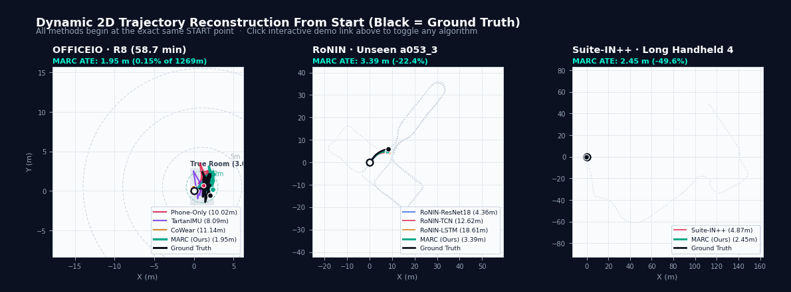
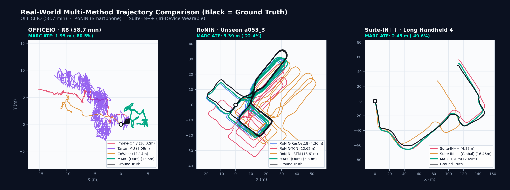
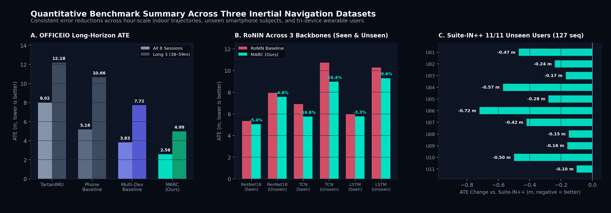

# MARC — Long-Horizon Inertial Trajectory Reconstruction

**Benchmark Results & Interactive Multi-Method Trajectory Observatory**

### 👉 [**Launch Interactive Trajectory Observatory (3 Datasets × Top 5 Live Replay)**](https://fanzhaorui744.github.io/-MARC-Motion-Aligned-Residual-Correction-/)

*Draw real trajectories dynamically from the origin against the black Ground Truth path, toggle individual competing algorithms on/off, switch between overlay & split-screen views, and inspect hour-scale drift dynamics.*

---

## Live Dynamic Trajectory Preview

  

  

---

## Key Quantitative Highlights

| Benchmark | Comparison | Metric | Baseline | **MARC (Ours)** | Improvement |
|---|---|---|---:|---:|---:|
| **OFFICEIO** (All 8 Sessions) | vs. TartanIMU | ATE (m) | 8.02 | **2.58** | **-67.9%** |
| **OFFICEIO** (Long 3: 38–59 min) | vs. Phone-Only Baseline | ATE (m) | 10.66 | **4.99** | **-53.2%** |
| **OFFICEIO** (Paired-5) | vs. CoWear | RTE-60s (m) | 1.70 | **0.61** | **-64.0%** |
| **RoNIN-TCN** (Unseen Subjects, 32 seq) | vs. RoNIN-TCN | ATE (m) | 10.73 | **8.97** | **-16.4%** |
| **Suite-IN++** (Unseen Users, 127 seq) | vs. Suite-IN++ | ATE (m) | 5.57 | **5.21** | **11 / 11 Users (81.4% Win Rate)** |

  

---

## Detailed Benchmark Comparisons

### 1. OFFICEIO — Long-Horizon Indoor Locomotion (up to 58.7 min)

| Method | All-8 ATE (m) ↓ | Long-3 ATE (m) ↓ | RTE-60s (m) ↓ | PRE (%) ↓ |
|---|---:|---:|---:|---:|
| TartanIMU | 8.02 | 12.18 | 1.30 | 1.99% |
| Phone-Only Baseline | 5.18 | 10.66 | 0.52 | — |
| Multi-Device Baseline | 3.83 | 7.72 | 0.49 | — |
| **MARC (Ours)** | **2.58** | **4.99** | **0.47** | **0.74%** |

### 2. RoNIN — Smartphone Pedestrian Navigation (32 Test Sequences per Split)

| Backbone | Split | Baseline ATE (m) ↓ | **MARC (Ours) ATE (m) ↓** | Reduction |
|---|---|---:|---:|---:|
| RoNIN-ResNet18 | Seen | 5.34 | **5.05** | **-5.4%** |
| RoNIN-ResNet18 | Unseen | 7.95 | **7.57** | **-4.8%** |
| RoNIN-TCN | Seen | 6.91 | **5.76** | **-16.6%** |
| RoNIN-TCN | Unseen | 10.73 | **8.97** | **-16.4%** |
| RoNIN-LSTM | Seen | 5.98 | **5.78** | **-3.3%** |
| RoNIN-LSTM | Unseen | 10.29 | **9.30** | **-9.6%** |

### 3. Suite-IN++ — Tri-Device Wearable Generalization

| Cohort | Suite-IN++ ATE (m) ↓ | **+ MARC (Ours) ATE (m) ↓** | RTE-60s (m) ↓ | Sequence Win Rate |
|---|---:|---:|---:|---:|
| Official Test (45 seq) | 3.19 | **2.97** | 3.59 → **3.33** | 69.6% |
| 11 Unseen Users (127 seq) | 5.57 | **5.21** | 5.72 → **5.40** | **81.4% (11 / 11 Users)** |

---

## Datasets Overview

- **OFFICEIO**: Real-world indoor workday benchmark with synchronized smartphone and smartwatch inertial sensors across 32 sessions (8.71 h total, 5.05 h paired), featuring continuous evaluation recordings up to **58.7 minutes**.
- **RoNIN**: Public smartphone pedestrian navigation benchmark covering handheld, pocket, and bag carrying modes across **Seen** and **Unseen** subjects (32 test trajectories per split) evaluated over ResNet18, TCN, and LSTM backbones.
- **Suite-IN++**: Synchronized tri-device wearable benchmark (**Smartphone + Smartwatch + Earbuds**) comprising 45 standard test sequences and 127 sequences across **11 completely unseen subjects**.
